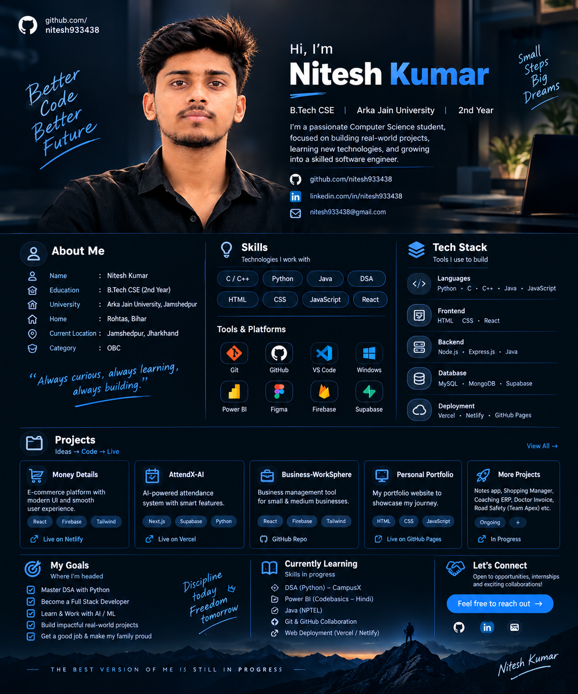

# 👋 Hey, I'm Nitesh Kumar

### Full-Stack Developer · MERN Stack · AI Enthusiast

  
  
  
  

---

## 👨‍💻 About Me

- 💻 Full-Stack Developer passionate about building practical digital products.
- 🌱 Learning and improving my skills in the MERN stack and modern web technologies.
- 🤖 Exploring AI integrations, intelligent automation, and useful developer tools.
- 🎨 Interested in premium UI/UX, responsive layouts, and accessible web experiences.
- 🚀 Focused on writing maintainable code and building real-world projects.
- 🤝 Open to collaboration, learning, and connecting with other developers.

 

---

## 🛠️ Tech Stack

**Languages**

**Frontend**

**Backend & Database**

**Tools & Platforms**

---

## 🚀 Featured Projects

<table>
  <tr>
    <td width="50%" valign="top">

### 💰 Money Details

A personal money-management project.

**Links:** [Repository](https://github.com/nitesh933438/Money-Details-Demo) · [Live Demo](https://nitesh933438.github.io/Money-Details/)

</td>
    <td width="50%" valign="top">

### 🤖 WhatsApp Personal AI Bot

A WhatsApp bot project with personal-assistant functionality.

**Links:** [Repository](https://github.com/nitesh933438/WhatsApp-Personal-AI-Bot-Demo) · [Live Demo](https://nitesh-personal-bot.onrender.com/)

</td>
  </tr>
  <tr>
    <td width="50%" valign="top">

### 🏢 WorkSphere HRMS

A human-resource management system project.

**Links:** [Repository](https://github.com/nitesh933438/WorkSphere-HRMS-Demo) · [Live Demo](https://nitesh933438.github.io/WorkSphere-HRMS-Demo-Source/)

</td>
    <td width="50%" valign="top">

### ✨ Nova AI Assistant

An AI assistant project with a web-based interface.

**Links:** [Repository](https://github.com/nitesh933438/nova-ai-assistant) · [Live Demo](https://nova-ai-assistant-oue3.onrender.com/)

</td>
  </tr>
  <tr>
    <td width="50%" valign="top">

### 🔐 Digital Vault

A digital information management project.

**Links:** [Repository](https://github.com/nitesh933438/Digital-Vault) · [Live Demo](https://nitesh933438.github.io/Digital-Vault/)

</td>
    <td width="50%" valign="top">

### 🌐 My Portfolio

My personal portfolio and project showcase.

**Links:** [Repository](https://github.com/nitesh933438/My-Portfolio) · [Live Demo](https://nitesh933438.github.io/My-Portfolio/)

</td>
  </tr>
  <tr>
    <td width="50%" valign="top">

### 🚦 Golden Road Safety

A road-safety-focused web project.

**Links:** [Repository](https://github.com/nitesh933438/Golden-Road-Safety) · [Live Demo](https://nitesh933438.github.io/Golden-Road-Safety/)

</td>
    <td width="50%" valign="top">

### 🧠 AttendX-AI

An AI-oriented attendance project.

**Links:** [Repository](https://github.com/nitesh933438/AttendX-AI) · [Live Demo](https://attend-x-ai.vercel.app/)

</td>
  </tr>
  <tr>
    <td width="50%" valign="top">

### 🛣️ Road Safety

A road-safety awareness web project.

**Links:** [Repository](https://github.com/nitesh933438/Road-Safety) · [Live Demo](https://road-safety-beta.vercel.app/)

</td>
    <td width="50%" valign="top">

### 📚 Explore All Projects

Browse my public repositories for more projects and experiments.

[**View All Repositories →**](https://github.com/nitesh933438?tab=repositories)

</td>
  </tr>
</table>

---

## 📊 GitHub Analytics

> **Note:** These three cards are loaded from external GitHub Stats services. If one is temporarily unavailable or rate-limited, it may appear blank; refresh the profile later. The cards do not require a separate GitHub Actions workflow.

---

## 🐍 Contribution Snake

  <picture>
    <source media="(prefers-color-scheme: dark)" srcset="https://raw.githubusercontent.com/nitesh933438/nitesh933438/output/github-contribution-grid-snake-dark.svg" />
    <source media="(prefers-color-scheme: light)" srcset="https://raw.githubusercontent.com/nitesh933438/nitesh933438/output/github-contribution-grid-snake.svg" />
    
  </picture>

---

## 📈 GitHub Metrics

  

---

## 📊 GitHub Summary Cards

---

## 🧑‍💻 Coding Profiles

---

## 🎯 Current Focus

- Building polished, responsive full-stack applications.
- Improving backend APIs, authentication, and database design.
- Exploring practical AI features and automation.
- Learning more about testing, security, and deployment.

## 🗺️ Goals for 2026

- 🚀 Ship more complete and production-minded projects.
- 📚 Strengthen MERN stack and software engineering fundamentals.
- 🔒 Improve application security, accessibility, and performance.
- 🤝 Contribute to open-source and collaborate with developers.

## 💬 Developer Quote

  

---

## 📚 All Public Repositories

<!-- REPOSITORY-LIST:START -->
_This list is updated automatically by GitHub Actions._

| Repository | Description | Language | Stars |
|---|---|---|---:|
| [Browse all repositories](https://github.com/nitesh933438?tab=repositories) | View all public repositories on GitHub. | — | — |
<!-- REPOSITORY-LIST:END -->

---

## 🤝 Let's Connect

I'm always interested in learning, building useful products, and connecting with the developer community.

### ⭐ Thanks for visiting my profile!

**If you like my work, consider giving a ⭐ to my repositories.**

